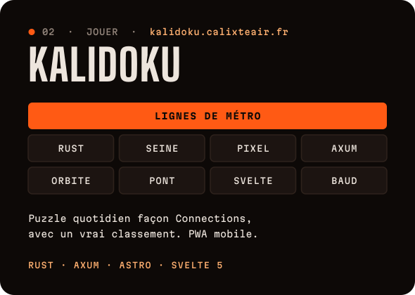
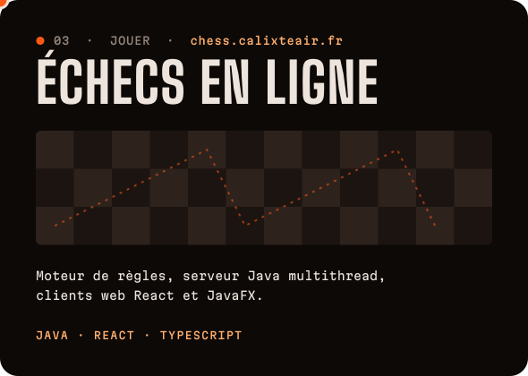

Étudiant ingénieur cyber à l'**ESIEA**, alternant à la **RATP**. Tout ce que je construis tourne sur un VPS que j'administre seul : Docker Compose, SSO Keycloak, secrets OpenBao, CI Jenkins et un SOC maison (Wazuh, Falco, CrowdSec, Prometheus, Grafana).

Les échecs, c'est quatre dépôts : <a href="https://github.com/Calixteair/chessGame">règles</a> · <a href="https://github.com/Calixteair/chessServer">serveur</a> · <a href="https://github.com/Calixteair/chessWeb">client web</a> · <a href="https://github.com/Calixteair/chessClientFX">client JavaFX</a>

### Aussi dans l'atelier

**[cyber-daily-brief](https://github.com/Calixteair/cyber-daily-brief)** veille cyber quotidienne rédigée par un agent Claude Code planifié 
**[DocConnect](https://github.com/Calixteair/DocConnect)** rendez-vous médicaux, téléconsultation Jitsi, chatbot d'orientation (Symfony 8) 
**[autoGymglish](https://github.com/Calixteair/autoGymglish)** extension Chrome MV3 qui répond aux exercices Gymglish via un LLM 
**[ai-jobs-docker](https://github.com/Calixteair/ai-jobs-docker)** dashboard Streamlit + MySQL sur le marché de l'emploi IA

### Outillage

 

Bannière, cartes et parcours générés par <a href="scripts/gen.py">scripts/gen.py</a> : texte vectorisé, animations en CSS pur.
