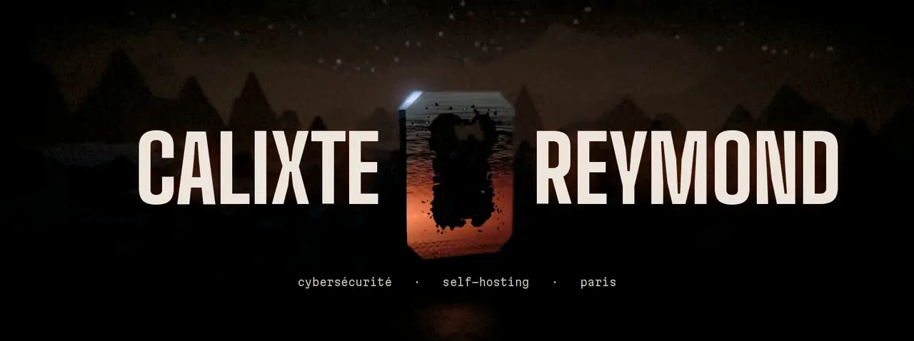
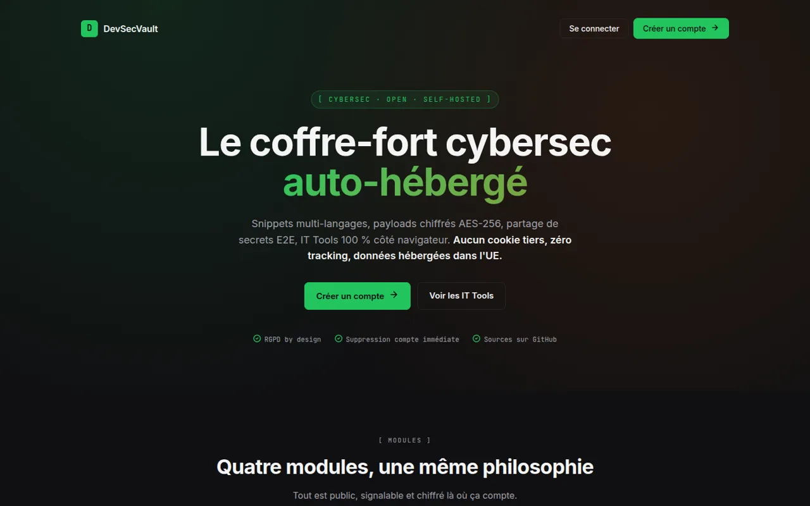
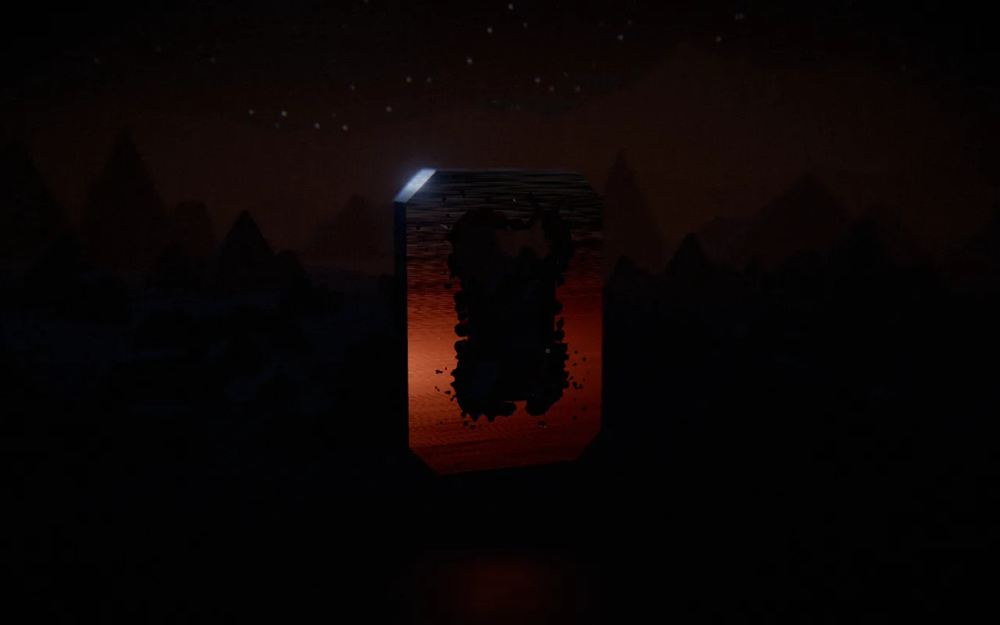
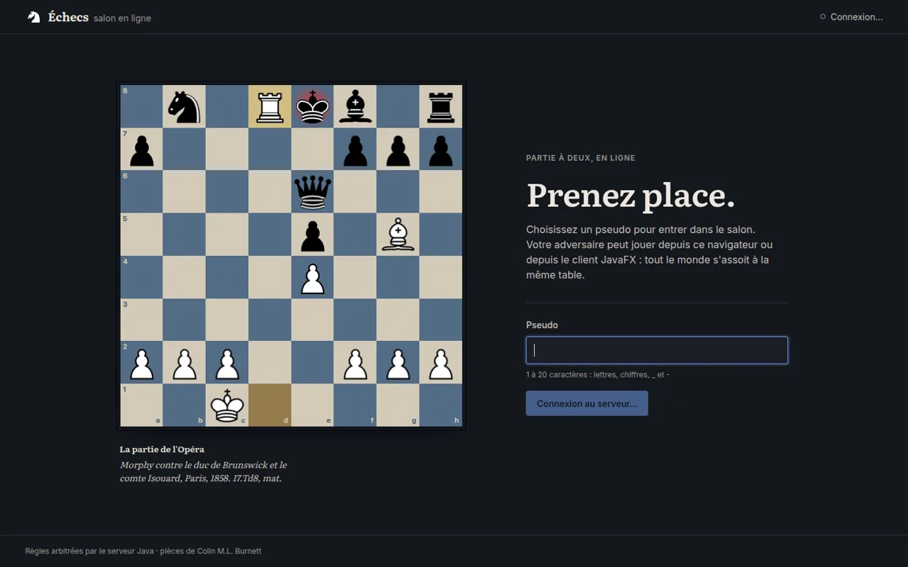

Cycle ingénieur cyber à l'ESIEA, alternant à la RATP. Avant ça, un BUT info à Belfort et un an de dev Java/Angular à la BRED.

Mes projets tournent sur un VPS que j'administre seul : Docker, Keycloak pour le SSO, OpenBao pour les secrets, Jenkins et GitHub Actions pour la CI, et un petit SOC (Wazuh, Falco, CrowdSec) qui surveille le tout.

### État du labo

| | En ligne | CI | Dernier commit |
|---|---|---|---|
| [DevSecVault](https://github.com/Calixteair/DevSecVault) |  |  |  |
| [Portfolio](https://github.com/Calixteair/portfolio) |  |  |  |
| [Échecs](https://github.com/Calixteair/chessWeb) |  |  |  |
| [kalidoku](https://github.com/Calixteair/kalidoku) |  |  |  |
| [cyber-daily-brief](https://github.com/Calixteair/cyber-daily-brief) |  |  |  |

Pastilles en direct, rafraîchies toutes les 5 minutes.

### En vitrine

<table>
<tr>
<td width="33%" valign="top"> <b><a href="https://github.com/Calixteair/DevSecVault">DevSecVault</a></b> Coffre-fort pour la cyber : payloads chiffrés AES-256-GCM, partage de secrets de bout en bout, outils 100 % navigateur. Angular 21, Symfony 8, Keycloak.</td>
<td width="33%" valign="top"> <b><a href="https://github.com/Calixteair/portfolio">Portfolio</a></b> Mon portfolio en 3D, la scène de la bannière. Astro, React Three Fiber, three.js, avec une version classique pour lire tranquille.</td>
<td width="33%" valign="top"> <b><a href="https://github.com/Calixteair/chessWeb">Échecs en ligne</a></b> Serveur Java multithread qui arbitre, <a href="https://github.com/Calixteair/chessGame">moteur de règles</a>, clients <a href="https://github.com/Calixteair/chessWeb">React</a> et <a href="https://github.com/Calixteair/chessClientFX">JavaFX</a> à la même table.</td>
</tr>
</table>

### Le reste

- [kalidoku](https://github.com/Calixteair/kalidoku) : un puzzle quotidien à la Connections, backend en Rust ([jouer](https://kalidoku.calixteair.fr))
- [cyber-daily-brief](https://github.com/Calixteair/cyber-daily-brief) : ma veille cyber, générée chaque matin par un agent Claude Code
- [DocConnect](https://github.com/Calixteair/DocConnect) : prise de rendez-vous médicaux avec téléconsultation, projet d'école
- [autoGymglish](https://github.com/Calixteair/autoGymglish) : une extension Chrome qui fait mes exercices Gymglish (je valide quand même à la main)
